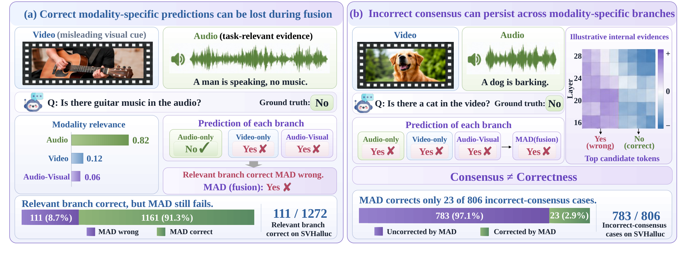
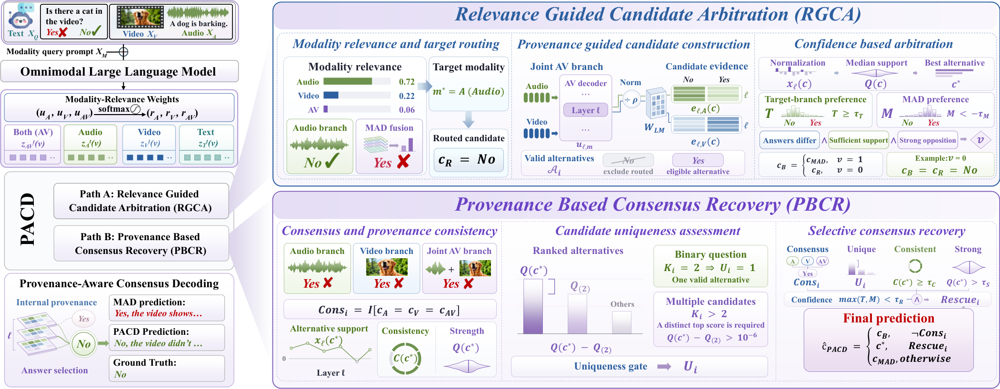
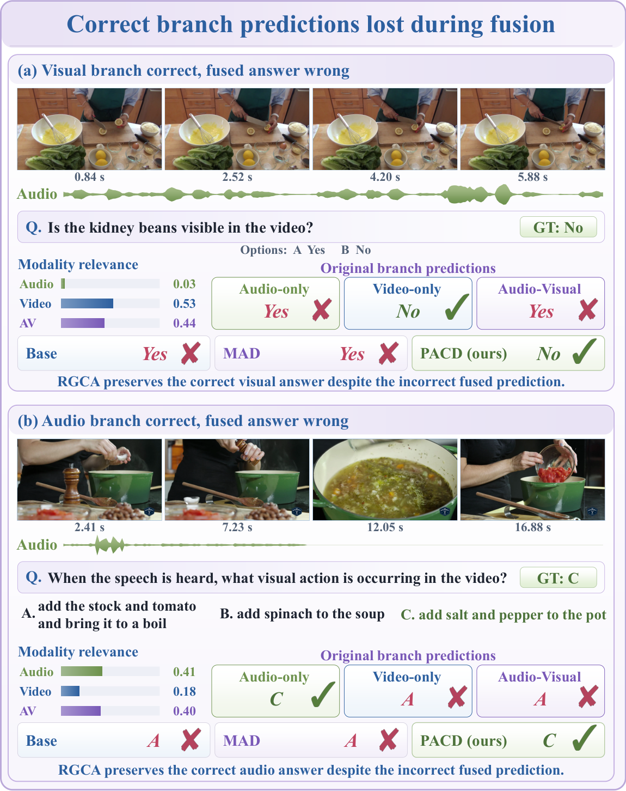
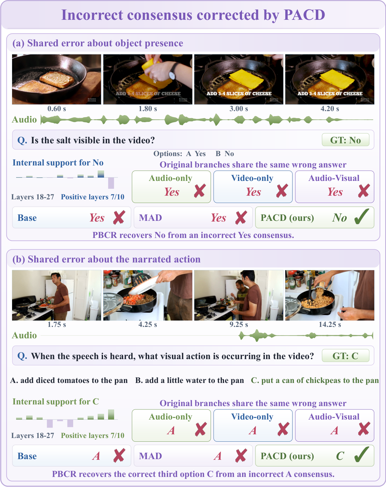
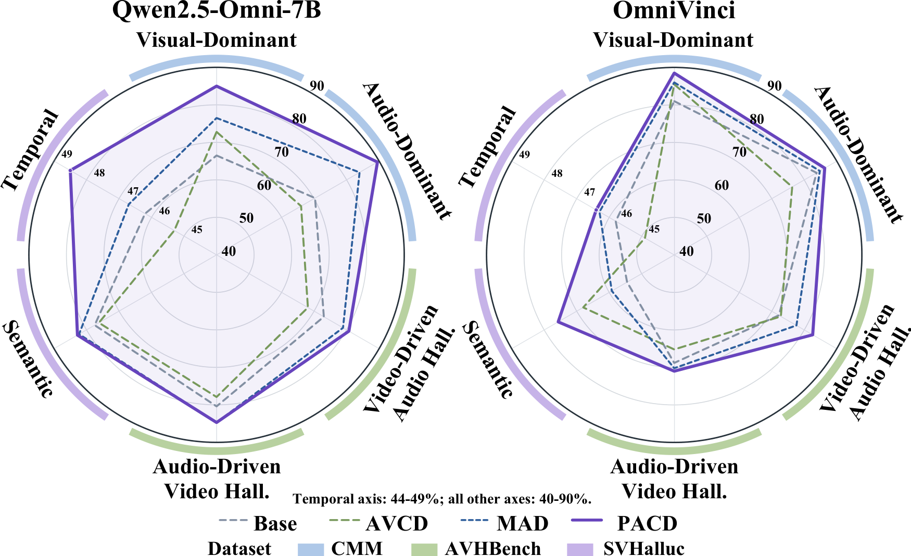
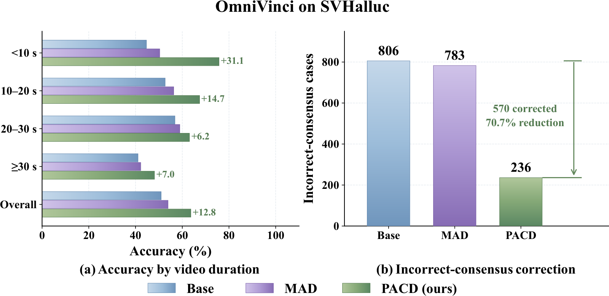

<div align="center">
  <p align="center">
    
  </p>
</div>


# PACD: Provenance-Aware Consensus Decoding for Mitigating Cross-Modal Hallucinations in Omnimodal Large Language Models

**A training-free decoding framework that preserves reliable modality-specific predictions and selectively recovers from incorrect agreement across audio-visual branches.**

---

## 💡 Motivation

Omnimodal large language models (Omni-LLMs) integrate audio, video, and text, but multimodal fusion does not always preserve task-relevant evidence. Existing relevance-weighted decoding can overlook a correct unimodal prediction, while multiple modality-conditioned branches may agree on the same incorrect answer.

A diagnostic analysis with OmniVinci on 2,405 SVHalluc questions identifies two challenges:

- **C1 — Neglect of reliable modality-specific predictions.** Among 1,272 cases in which the most relevant unimodal branch is correct, relevance-weighted MAD nevertheless makes 111 incorrect predictions.
- **C2 — Persistence of erroneous consensus.** The audio-only, video-only, and joint audio-visual branches agree on 1,791 cases, of which 806 are incorrect. MAD corrects only 23 of these 806 incorrect-consensus cases, leaving 783 unresolved (**97.1%**).

> **Branch relevance alone cannot guarantee faithful fusion, and agreement among branches cannot guarantee correctness. PACD examines candidate-level provenance evidence to decide when to preserve a routed prediction and when to challenge a shared error.**

### Motivation of PACD

<p align="center">
  
</p>


### Overview of PACD

<p align="center">
  
</p>


---

## 🧠 Method

PACD follows two complementary paths depending on whether the audio-only (A), video-only (V), and joint audio-visual (AV) branches reach consensus. It is a training-free framework comprising Relevance-Guided Candidate Arbitration (RGCA) and Provenance-Based Consensus Recovery (PBCR).

### 1. Relevance-Guided Candidate Arbitration (RGCA)

For non-consensus cases, RGCA identifies the most query-relevant unimodal branch. Given the modality-relevance scores (<i>r</i><sub>A</sub>, <i>r</i><sub>V</sub>, <i>r</i><sub>AV</sub>), the target modality and routed candidate are selected as

```math
m^{*} =
\begin{cases}
A, & r_A > r_V, \\
V, & r_A \le r_V,
\end{cases}
\qquad c_R = c_{m^{*}}.
```

For question <i>i</i>, let 𝒞<sub><i>i</i></sub> denote the valid answer candidates. Given <i>c</i><sub>R</sub>, RGCA constructs the alternative set

```math
\mathcal{A}_i = \mathcal{C}_i \setminus \{c_R\}.
```

RGCA uses candidate-logit contributions <i>e</i><sub>ℓ,<i>m</i></sub>(<i>c</i>) extracted from the joint audio-visual branch to compare each alternative with the routed candidate. For the selected modality <i>m</i><sup>∗</sup>, the normalized layer-wise provenance evidence is

```math
\begin{aligned}
d_{\ell,m}(c) &= e_{\ell,m}(c) - e_{\ell,m}(c_R), \\
x_{\ell}(c) &= \frac{d_{\ell,m^{*}}(c)}{s_e(c)}.
\end{aligned}
```

Here, <i>s</i><sub>e</sub>(<i>c</i>) is the candidate-specific contribution scale defined over the examined layers ℒ<sub>N</sub> in the paper. The strongest alternative is selected using the median provenance evidence:

```math
c^{*} = \arg\max_{c\in\mathcal{A}_i} Q(c),
\qquad
Q(c) = \mathrm{median}_{\ell\in\mathcal{L}_{N}} x_{\ell}(c).
```

RGCA then compares the candidate-logit margins from the target branch and MAD, normalized by <i>s</i><sub>z</sub>:

```math
T = \frac{z_{m^{*}}^{t}(c_R)-z_{m^{*}}^{t}(c^{*})}{s_z},
\qquad
M = \frac{z_{\mathrm{MAD}}^{t}(c_R)-z_{\mathrm{MAD}}^{t}(c^{*})}{s_z}.
```

A confidence veto determines whether the routed prediction should be replaced by the MAD prediction:

```math
v = \mathbb{I}[c_R\ne c_{\mathrm{MAD}}]
\land \mathbb{I}[T<\tau_T]
\land \mathbb{I}[M<-\tau_M].
```

RGCA outputs <i>c</i><sub>B</sub> = <i>c</i><sub>MAD</sub> when <i>v</i> = 1, and <i>c</i><sub>B</sub> = <i>c</i><sub>R</sub> otherwise. The alternative <i>c</i><sup>∗</sup> serves as comparative provenance evidence.

### 2. Provenance-Based Consensus Recovery (PBCR)

For consensus cases, PBCR examines whether an alternative candidate should replace the shared branch prediction. Motivated by the non-compensatory outranking principle, it combines provenance consistency and strength, candidate uniqueness, and confidence constraints.

The consensus condition and cross-layer provenance concordance are

```math
\mathrm{Cons}_i = \mathbb{I}[c_A=c_V=c_{AV}],
\qquad
C(c^{*}) = \frac{1}{|\mathcal{L}_{N}|}
\sum_{\ell\in\mathcal{L}_{N}}\mathbb{I}[x_{\ell}(c^{*})>0].
```

- Cross-layer concordance <i>C</i>(<i>c</i><sup>∗</sup>): the proportion of examined layers supporting the alternative.
- Evidence strength <i>Q</i>(<i>c</i><sup>∗</sup>): the median normalized provenance evidence.
- Candidate uniqueness <i>U</i><sub><i>i</i></sub>: whether the alternative has sufficiently distinct provenance support; binary questions have a unique alternative.
- Confidence constraints: a veto-like condition based on max(<i>T</i>, <i>M</i>).

PBCR applies the non-compensatory recovery rule:

```math
\mathrm{Rescue}_i = \mathrm{Cons}_i \land U_i \land
\mathbb{I}[C(c^{*})\ge\tau_C] \land
\mathbb{I}[Q(c^{*})>\tau_S] \land
\mathbb{I}[\max(T,M)<\tau_R].
```

The conditions restrict recovery to candidates meeting the specified provenance consistency, evidence strength, uniqueness, and confidence criteria.

### 3. Final PACD Decision

The final prediction follows the consensus-dependent decision rule in the paper:

```math
\hat{c}_{\mathrm{PACD}} =
\begin{cases}
c_B, & \neg\mathrm{Cons}_i, \\
c^{*}, & \mathrm{Rescue}_i, \\
c_{\mathrm{MAD}}, & \text{otherwise}.
\end{cases}
```

Non-consensus cases use the RGCA prediction <i>c</i><sub>B</sub>. Consensus cases adopt <i>c</i><sup>∗</sup> only when the PBCR recovery conditions hold; otherwise, PACD retains <i>c</i><sub>MAD</sub>.

---

## 🎬 Qualitative Examples

The examples below show both types of errors addressed by PACD.

### RGCA: Preserving a Correct Unimodal Answer

<p align="center">
  
</p>


In the first example, the video-only branch correctly predicts No, while the audio-only and joint AV branches predict Yes; PACD outputs No. In the second example, the audio-only branch correctly chooses C, while the video-only and joint AV branches choose A; PACD outputs C.

### PBCR: Recovering from Incorrect Consensus

<p align="center">
  
</p>


In both examples, the A, V, and AV branches share the same incorrect prediction. The alternative receives cross-layer provenance support, and the full PACD decision recovers the correct answer. The visualized positive layers illustrate concordance but do not alone establish the complete PBCR recovery criterion.

---

## 📊 Main Results: Cross-Modal Hallucination Mitigation

PACD is evaluated on four Omni-LLM backbones and three cross-modal hallucination benchmarks: **CMM (800 questions)**, **AVHBench (3,426 questions)**, and **SVHalluc (2,405 questions)**.

### Overall Accuracy (%)

|     Backbone      | CMM Base | CMM MAD | **CMM PACD** | AVHBench Base | AVHBench MAD | **AVHBench PACD** | SVHalluc Base | SVHalluc MAD | **SVHalluc PACD** |
| :---------------: | :------: | :-----: | :----------: | :-----------: | :----------: | :---------------: | :-----------: | :----------: | :---------------: |
| VideoLLaMA2-AV-7B |   77.3   |  80.9   |   **82.4**   |     72.6      |     78.8     |     **80.6**      |     51.7      |     56.7     |     **60.4**      |
|     OmniVinci     |   82.4   |  85.4   |   **87.4**   |     71.1      |     75.1     |     **78.8**      |     50.9      |     53.9     |     **63.7**      |
|  Qwen2.5-Omni-3B  |   78.0   |  80.4   |   **84.6**   |     75.8      |     80.9     |     **82.4**      |     60.2      |     64.5     |     **65.6**      |
|  Qwen2.5-Omni-7B  |   68.4   |  80.3   |   **87.3**   |     75.5      |     80.8     |     **82.0**      |     64.7      |     67.8     |     **68.8**      |

PACD improves overall accuracy across all 12 model–benchmark combinations. Its largest relative gain over Base is 27.6% (Qwen2.5-Omni-7B on CMM), and its largest absolute improvement over MAD is 9.8 percentage points (OmniVinci on SVHalluc).

### PACD Subcategory Accuracy (%)

|     Backbone      | CMM Visual Dom. | CMM Audio Dom. | CMM Overall | AVH Video-Driven Audio Hall. | AVH Audio-Driven Video Hall. | AVH Overall | SVHalluc Sem. | SVHalluc Temp. | SVHalluc Overall |
| :---------------: | :-------------: | :------------: | :---------: | :--------------------------: | :--------------------------: | :---------: | :-----------: | :------------: | :--------------: |
| VideoLLaMA2-AV-7B |      86.5       |      78.3      |    82.4     |             81.2             |             79.4             |    80.6     |     71.0      |      45.0      |       60.4       |
|     OmniVinci     |      88.5       |      86.3      |    87.4     |             82.6             |             71.0             |    78.8     |     75.7      |      46.4      |       63.7       |
|  Qwen2.5-Omni-3B  |      80.8       |      88.5      |    84.6     |             82.7             |             81.8             |    82.4     |     78.0      |      47.6      |       65.6       |
|  Qwen2.5-Omni-7B  |      85.0       |      89.5      |    87.3     |             80.7             |             84.7             |    82.0     |     82.8      |      48.5      |       68.8       |

### Visual Comparison

<p align="center">
  
</p>


---

## 🔬 Component Ablation

**OmniVinci**, accuracy (%):

|    Variant     |   CMM    | AVHBench | SVHalluc |
| :------------: | :------: | :------: | :------: |
|      Base      |   82.4   |   71.1   |   50.9   |
|    Routing     |   83.5   |   74.3   |   53.6   |
|      RGCA      |   86.9   |   77.7   |   54.0   |
| Routing + PBCR |   84.0   |   75.6   |   62.9   |
| **Full PACD**  | **87.4** | **78.8** | **63.7** |

Routing selects the most relevant unimodal branch. RGCA adds provenance-guided arbitration. Routing + PBCR uses the routed candidate as its default prediction and applies consensus recovery; Full PACD applies the complete consensus-dependent decision rule.

---

## 🌐 General Audio-Visual Reasoning

PACD also improves performance on **OmniVideoBench** and **FutureOmni** beyond hallucination-specific evaluation.

|     Backbone / Method      | OmniVideoBench | FutureOmni |
| :------------------------: | :------------: | :--------: |
|   VideoLLaMA2-AV-7B Base   |      27.5      |    38.8    |
|   VideoLLaMA2-AV-7B MAD    |      28.3      |    36.3    |
| **VideoLLaMA2-AV-7B PACD** |    **31.1**    |  **40.0**  |
|       OmniVinci Base       |      32.9      |    52.7    |
|       OmniVinci MAD        |      32.5      |    51.7    |
|     **OmniVinci PACD**     |    **34.8**    |  **53.5**  |

The four relative improvements over MAD are 9.9%, 10.2%, 7.1%, and 3.5%, giving an arithmetic mean relative improvement of 7.7% over MAD.

---

## ⚡ Computational Efficiency

Average reported inference latency and peak GPU memory on **VideoLLaMA2-AV-7B**:

| Method | CMM Latency | CMM Peak GPU Memory | AVHBench Latency | AVHBench Peak GPU Memory |
|:-------|------------:|--------------------:|-----------------:|-------------------------:|
| AVCD   | 1.70 s      | 22.6 GB             | 1.40 s           | 22.7 GB                  |
| MAD    | 1.41 s      | 20.7 GB             | 1.40 s           | 20.7 GB                  |
| **PACD** | **1.45 s** | **20.7 GB**        | **1.44 s**       | **20.7 GB**              |

PACD achieves inference latency comparable to MAD while maintaining the same peak GPU memory usage.

---

## 📈 Robustness and Incorrect-Consensus Recovery

<p align="center">
  
</p>


For OmniVinci on SVHalluc, PACD improves accuracy by 31.1, 14.7, 6.2, and 7.0 percentage points over Base in the four displayed video-duration groups. Among the 806 initially incorrect-consensus cases, MAD corrects only 23, leaving 783 unresolved. In contrast, PACD corrects 570 cases, reducing the number of remaining incorrect cases to 236, corresponding to a 70.7% reduction relative to the initial count.

---

## 🗂️ Repository Structure

```text
PACD_Github/
├── README.md
└── assets/
    └── figures/
        ├── logo.png
        ├── motivation.png
        ├── framework.png
        ├── main_results.png
        ├── duration_and_consensus.png
        ├── rgca_examples.png
        └── pbcr_examples.png
```

---

## 📦 Release Plan

The following will be released after submission:

- ⏳ PACD decoding implementation.
- ⏳ Evaluation scripts for CMM, AVHBench, SVHalluc, OmniVideoBench, and FutureOmni.
- ⏳ Model-specific configurations for VideoLLaMA2-AV, OmniVinci, and Qwen2.5-Omni (3B/7B).

---

## ⭐ Acknowledgment

If you find this project interesting, feel free to star or watch the repository for future updates.


---

## 📖 Cite

```bibtex
@article{sun2026pacd,
  title={PACD: Provenance-Aware Consensus Decoding for Mitigating Cross-Modal Hallucinations in Omnimodal Large Language Models},
  author={Sun, Chang and Tian, Yijun and Tang, Zhenwei and Deng, Yuchen and Liu, Yifan Simon and Wang, Chenxu and Wang, Wei},
  journal={arXiv preprint arXiv:2611.22456},
  year={2026}
}
```

